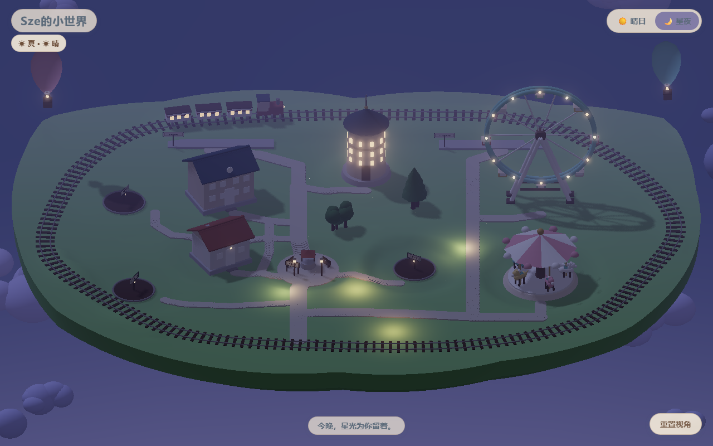

# 🏝️ 我的云上乐园 · Sze's Little World

一个可以跑、可以玩的 3D 漂浮森林小镇，用 [Three.js](https://threejs.org/) + [Vite](https://vite.dev/) 构建，全部程序化生成（零外部模型）。三个街区 —— 带车站和广场的镇中心、林间社区、游乐草坪 —— 由一条小铁路和砾石小路串在一起。

> A runnable, interactive 3D floating woodland town built with Three.js. Three districts — a town centre with a station and square, a woodland neighbourhood, and an amusement meadow — are linked by a small railway and a network of gravel walks. Everything is procedural (no external models).

**🌐 在线体验 / Live demo:** <https://szexiaoming.github.io/cloud-amusement-park/>

<p align="center">
  
</p>

## ✨ 特色 / Features

### 🏡 小镇与游乐设施 / The town & rides

- **漂浮岛（Floating island）** — 草地平台、圆润的边缘、起伏的地形、锥形岩石底部、垂挂的植物、奶油色小路、实例化的花草、低矮围栏、长椅，以及带星星纹样的「我的云上乐园」入口牌。
- **摩天轮（Ferris wheel）** — 圆环轮圈、辐条、A 形支架，8 个始终保持直立的轿厢。
- **旋转木马（Carousel）** — 奶油/蜜桃色条纹顶棚、中心立柱，5 匹上下起伏的小马。
- **小镇火车（小火车）** — 一条温馨的封闭环线，按顺序串联三个街区（A → B → C），配有小木站台；火车头带两节车厢慢悠悠地兜圈，车头灯在夜晚亮起。
- **入口小岛与渡船** — 从入口岛出发，Q 版小人（Sze）乘小船渡到主岛码头，也可以在岛上用 A* 网格寻路散步。
- **环境细节** — 布置好的阔叶树/松树、灌木、菜园、木制路灯（夜晚发光）和指路牌。

### 🌗 氛围系统 / Atmosphere

- **昼夜系统（Day / Night）** — 右上角太阳/月亮切换（晴日 / 星夜），存入 localStorage，约 2 秒交叉淡化天空渐变、雾、光照、自发光和粒子；快速切换不会闪烁。
- **夜晚氛围** — 靛蓝 → 薰衣草紫的天空渐变、清冷月光、淡紫环境光、带淡紫调的云和稀疏闪烁的星星。
- **暖色公园灯光** — 摩天轮轮圈和顶棚上的发光灯泡、星纹路灯，以及少量共享点光源，桌面端带克制的泛光（bloom）。
- **萤火虫** — 花丛、草地和长椅旁的柔和加性光点，四处游走、呼吸闪烁，白天淡出。
- **季节（Seasons）** — 春/夏/秋/冬跟随电脑的真实日期；草地、树木、灌木和飘落的花瓣/落叶/雪花随之变化。
- **真实天气（Real weather）** — 从 [Open-Meteo](https://open-meteo.com/)（免费、无需 API key）获取，配合浏览器定位。晴/多云/雾/雨/雪/暴风雨会改变光照、雾和雨雪粒子；界面左上角的小徽章显示季节 + 天气 + 温度。

### 🧭 个人小镇与街区卡 / Districts & memory cards

- **云上小城（Personal town）** — 数据驱动的街区层：人生每一章对应一栋建筑，并为未来街区预留地块。
- **街区（Districts）** — A 回忆小屋（cottage）、B 知识学园（academy）、C AI 研究塔（research tower），以及 D 机器人工坊 / E 创造工作室 / G 未来车站的预留地块，F 星光游乐园围绕其间。
- **街区卡（District cards）** — 点击建筑会打开一张温馨的日记卡片：字母徽章、中英文名称、主题、标签、故事、项目展示（标题 / 简介 / 技术栈 / 链接）和备注。内容全部是 `DISTRICTS` 里的纯数据。
- **自然材质** — 石材、灰泥、木材、瓦片/石板屋顶、泥土和树叶绿，配以更暖的阳光和更柔和的阴影。

### 🖱 交互与无障碍 / Interaction & accessibility

- **交互** — 阻尼+限位的轨道缩放、悬停高亮（中文标签）、点击暂停、拖拽/点按区分、「重置视角」按钮、触摸支持、delta-time 动画、像素比上限。
- **无障碍** — 移动端降级（关闭 bloom、减少萤火虫），支持 `prefers-reduced-motion`（即时过渡、不再游走）。

## 🚀 快速开始 / Setup

要求：Node.js 18+ 和 pnpm（或 npm）。

```bash
pnpm install
pnpm dev       # 启动开发服务器，打开输出的 URL
```

生产构建：

```bash
pnpm build     # 输出静态站点到 dist/
pnpm preview   # 本地预览构建产物
```

仓库每次 push 到 `main` 都会通过 GitHub Actions 自动构建并部署到 GitHub Pages。

可以用 `?mode=night`（或 `?mode=day`）深链直达某个模式，用 `?card=research` 直接预览某张街区卡。

## 🌦 季节与真实天气 / Seasons & real weather

- **季节**跟随电脑的真实日期（北半球）：春 3–5 月、夏 6–8 月、秋 9–11 月、冬 12–2 月。调色板在 `SEASONS`（`src/season.js`）里。
- **天气**来自 [Open-Meteo](https://open-meteo.com/)（免费、无需 API key）。浏览器会请求定位；拒绝后使用 `WEATHER.fallback`（`src/config.js`）中的默认值。设 `WEATHER.enabled = false` 可完全关闭。
- **预览**某个季节/天气，无需等日期：`?season=winter&weather=snow`、`?season=autumn&weather=rain`、`?season=spring`、`?weather=fog`、`?weather=storm`。
- 标题下方的小徽章会显示例如 `🍂 秋 · 🌧 雨 12°C`；网络或定位不可用时显示 `秋 · 天气未知`，绝不瞎猜。

## 🏘 添加一个街区 / Add a district

小镇的一切都住在 `DISTRICTS` 数组里（`src/districts.js`）。要新增或编辑街区，复制一条记录改一改即可：

```js
{
  id: 'myDistrict',            // 唯一 id（也用于 ?card=<id>）
  letter: 'H',                 // 卡片徽章上的章节字母
  name: '我的新街区',           // 中文标题
  englishName: 'My District',  // 英文副标题
  theme: '主题 · 关键词',       // 一行主题
  position: P3(-9.0, 0, 6.0), // 设计空间坐标（会乘以 WORLD_SCALE）
  building: 'cottage',         // 'cottage' | 'academy' | 'tower' | 'reserved'
  status: 'built',             // 'built' | 'planned'
  tags: ['关键词'],             // 小标签
  story: '示例文字：……',        // 故事段落
  projects: [                  // 可选的项目展示
    { title: '…', summary: '…', stack: ['…'], links: [{ label: '链接', url: 'https://…' }] },
  ],
  note: '备注 / 待补充说明。',
}
```

就这样 —— 建筑（或预留地块）、悬停高亮、标签和点击开卡的行为全部来自数据。

- `building: 'reserved'` 渲染一块标记好的预留地 + 指路牌；它的卡片展示规划中的内容（D / E / G 用的就是它）。
- `WORLD_SCALE`（`config.js` 顶部）控制整座岛的大小。位置用 `P2` / `P3` / `B3` 写在设计空间里并自动缩放 —— 改一个数字就能让整座小镇变大。
- 建筑、小路、铁路点位/站台、树丛、山丘和广场道具都在 `src/townPlan.js` 里。往 `PLAN.buildings` 追加一条（`pos` + `face`）即可加建筑，入口和铁路/植被系统会自动跟随规划。

## 📁 项目结构 / Structure

```
├── index.html              页面骨架与全部 UI 样式
├── src/
│   ├── main.js             入口：渲染器、相机、灯光、循环、bloom、控制器、
│   │                       车站选择、火车漫游 + 跟随相机
│   ├── townPlan.js         小镇总规划：街区、建筑、小路、铁路、站台、树丛、山丘、广场道具
│   ├── config.js           世界名、调色板、环境预设、天气、bloom
│   ├── districts.js        街区数据（id/名称/故事/项目/标签/备注 + 授权坐标）
│   ├── districtBuildings.js 记忆建筑：cottage / academy / tower / reserved 地块
│   ├── town.js             按授权坐标放置每栋建筑
│   ├── avatar.js           Q 版小人 Sze（大头大眼短四肢）
│   ├── boat.js             入口岛 → 主岛码头的渡船
│   ├── entrance.js         入口小岛：圆顶浮岛、欢迎牌、石板路、灯笼、长椅、码头
│   ├── mountain.js         铁路两侧穿隧道的两座山
│   ├── nav.js              小人散步用的 A* 网格寻路（绕开所有实心物）
│   ├── terrain.js          不规则岛形、边缘、底部、山丘
│   ├── buildings.js        可复用的小屋/商店/站台/温室/岗亭/图书馆工厂
│   ├── paths.js            砾石小路 + 木板道口
│   ├── railway.js          铁路环线、枕木、站台、停站火车
│   ├── vegetation.js       分层树丛、灌木、花丛
│   ├── props.js            广场水井、公告板、长椅、路灯
│   ├── attractions/
│   │   ├── ferrisWheel.js  摩天轮（含轮圈灯泡）
│   │   └── carousel.js     旋转木马（含顶棚灯泡）
│   ├── clouds.js           球体合并的云朵
│   ├── balloons.js         车削生成的热气球（夜晚有燃烧器）
│   ├── environment.js      昼夜预设 + 过渡控制器
│   ├── sky.js              渐变天空穹顶
│   ├── decorativeLights.js 灯泡、共享点光源
│   ├── particles.js        萤火虫 + 星星
│   ├── season.js           四季 + 花瓣/落叶/雪花
│   ├── weather.js          真实天气（Open-Meteo）+ 雨/雪/雾
│   ├── memoryCard.js       点击打开的「日记」卡片
│   ├── interaction.js      悬停/点击 + 标签 + 拖拽判定
│   ├── helpers.js          圆角盒子、圆柱、星纹、实例化
│   └── materials.js        共享的可复用材质
├── design/                 总体规划预览、布局 JSON、设计说明
└── screenshots/            README 截图
```
